# Free HTML5 Games

25 complete browser games, each in **one HTML file** with no libraries, no build step and no assets to download. Open a file in a browser and it runs, on desktop or phone. Every game is MIT-licensed, so you can learn from it, change it and ship it, including commercially.

**[Play them all in your browser →](https://bytenimble.github.io/free-html5-games/)**

Each game comes with a step-by-step tutorial on [html5gamesstudio.com](https://html5gamesstudio.com/html-game-code) that walks through how it works: the loop, input, collisions and drawing.

## Why these exist

Most free game code online is a fragment that needs other files, or a minified build nobody can read. These follow the same rules:

- **Complete:** one file, nothing to install, works offline.
- **Readable:** plain JavaScript with comments, about 175 to 400 lines each.
- **Works on phones:** touch or swipe controls, and a canvas that resizes with the screen.
- **Explained:** each one has a tutorial.
- **Free:** MIT license.

## The games

| | Game and what it teaches | Level | Lines | Links |
|---|---|---|---|---|
| 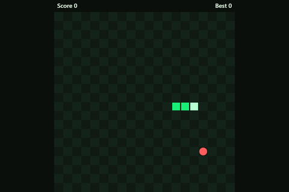 | **Snake**<br>Game loop, keyboard and swipe input, grid collisions, scoring | Beginner | 177 | [Play](https://bytenimble.github.io/free-html5-games/games/snake/) · [Code](games/snake/index.html) · [Tutorial](https://html5gamesstudio.com/html-game-code/snake) |
| 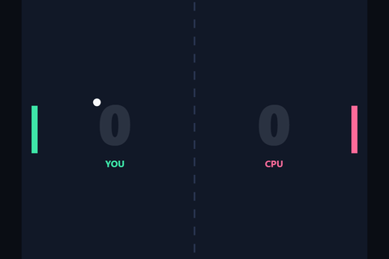 | **Paddle Duel (Pong-style)**<br>Fixed-step physics, paddle aiming, a computer opponent | Beginner | 252 | [Play](https://bytenimble.github.io/free-html5-games/games/pong/) · [Code](games/pong/index.html) · [Tutorial](https://html5gamesstudio.com/html-game-code/pong) |
| 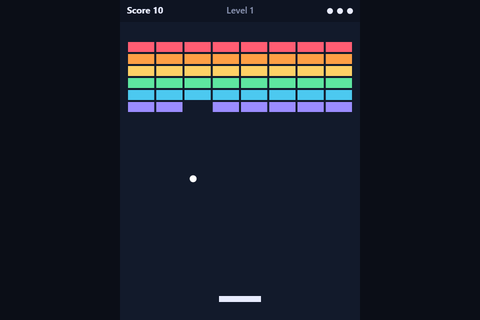 | **Brick Burst (brick breaker)**<br>Ball physics, circle-vs-rectangle collisions, levels and lives | Beginner | 253 | [Play](https://bytenimble.github.io/free-html5-games/games/breakout/) · [Code](games/breakout/index.html) · [Tutorial](https://html5gamesstudio.com/html-game-code/breakout) |
| 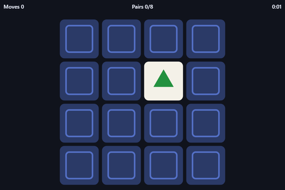 | **Memory Match**<br>Shuffling, card flips, pair checks, scoring | Beginner | 266 | [Play](https://bytenimble.github.io/free-html5-games/games/memory-game/) · [Code](games/memory-game/index.html) · [Tutorial](https://html5gamesstudio.com/html-game-code/memory-game) |
| 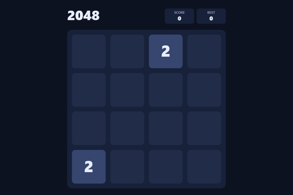 | **2048**<br>Slide-and-merge rules, tile animation, swipes, game over | Beginner | 262 | [Play](https://bytenimble.github.io/free-html5-games/games/2048/) · [Code](games/2048/index.html) · [Tutorial](https://html5gamesstudio.com/html-game-code/2048) |
| 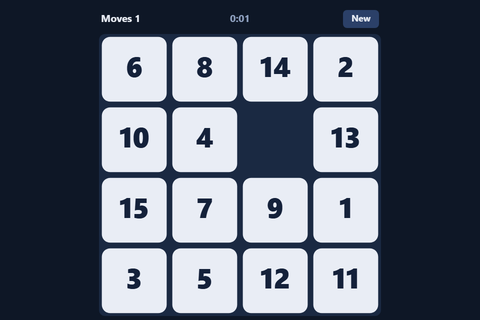 | **Slide 15 (sliding puzzle)**<br>Solvable shuffles, tile sliding, move counting | Beginner | 244 | [Play](https://bytenimble.github.io/free-html5-games/games/puzzle-game/) · [Code](games/puzzle-game/index.html) · [Tutorial](https://html5gamesstudio.com/html-game-code/puzzle-game) |
| 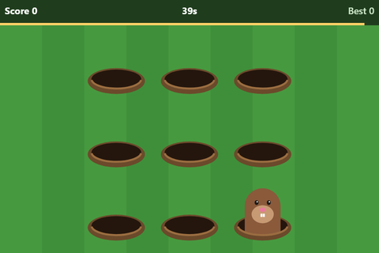 | **Burrow Bop (whack-a-mole)**<br>Pop-up timing, rising speed, hit boxes | Beginner | 310 | [Play](https://bytenimble.github.io/free-html5-games/games/whack-a-mole/) · [Code](games/whack-a-mole/index.html) · [Tutorial](https://html5gamesstudio.com/html-game-code/whack-a-mole) |
| 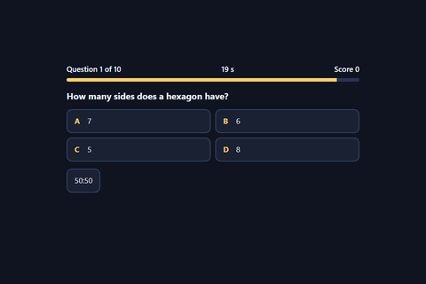 | **Quick Quiz**<br>Question data, a timer, 50:50 help, scoring with real buttons | Beginner | 248 | [Play](https://bytenimble.github.io/free-html5-games/games/quiz-game/) · [Code](games/quiz-game/index.html) · [Tutorial](https://html5gamesstudio.com/html-game-code/quiz-game) |
| 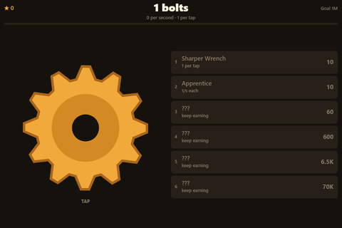 | **Bolt Workshop (clicker / idle)**<br>Rising costs, passive income, big numbers, prestige | Beginner | 252 | [Play](https://bytenimble.github.io/free-html5-games/games/clicker-game/) · [Code](games/clicker-game/index.html) · [Tutorial](https://html5gamesstudio.com/html-game-code/clicker-game) |
| 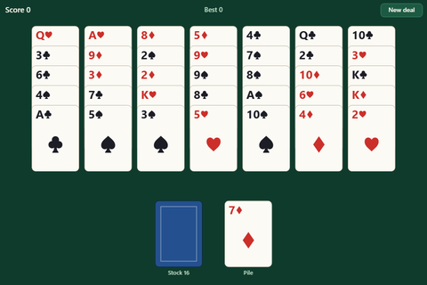 | **Golf Solitaire**<br>A deck, shuffling, solitaire rules, tap controls | Beginner | 260 | [Play](https://bytenimble.github.io/free-html5-games/games/card-game/) · [Code](games/card-game/index.html) · [Tutorial](https://html5gamesstudio.com/html-game-code/card-game) |
| 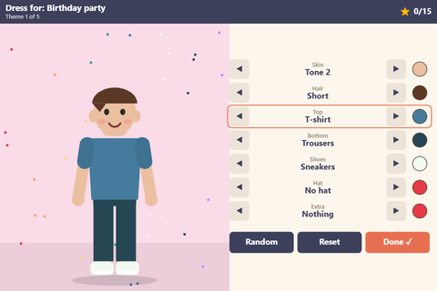 | **Wardrobe Studio (dress-up)**<br>Clothing slots, colours, layering, outfit rating | Beginner | 342 | [Play](https://bytenimble.github.io/free-html5-games/games/dress-up-game/) · [Code](games/dress-up-game/index.html) · [Tutorial](https://html5gamesstudio.com/html-game-code/dress-up-game) |
| 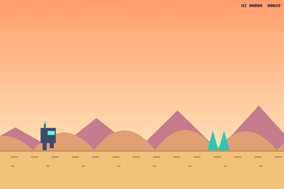 | **Sprint Bot (endless runner)**<br>Jumping and ducking, obstacle spawning, rising speed | Beginner | 294 | [Play](https://bytenimble.github.io/free-html5-games/games/endless-runner/) · [Code](games/endless-runner/index.html) · [Tutorial](https://html5gamesstudio.com/html-game-code/endless-runner) |
| 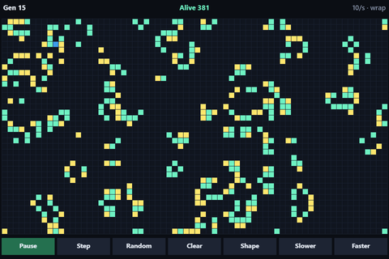 | **Conway's Game of Life**<br>Cellular automata, drawing cells, play, pause and step | Beginner | 286 | [Play](https://bytenimble.github.io/free-html5-games/games/game-of-life/) · [Code](games/game-of-life/index.html) · [Tutorial](https://html5gamesstudio.com/html-game-code/game-of-life) |
| 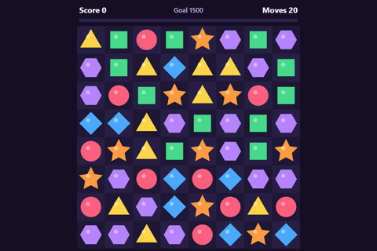 | **Gem Swap (match-3)**<br>Swaps, match detection, gravity, refills, cascades | Intermediate | 384 | [Play](https://bytenimble.github.io/free-html5-games/games/match-3/) · [Code](games/match-3/index.html) · [Tutorial](https://html5gamesstudio.com/html-game-code/match-3) |
| 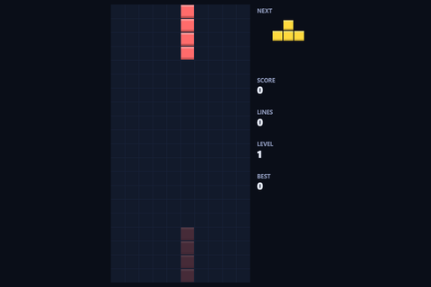 | **Block Drop (falling blocks)**<br>Piece rotation, wall kicks, line clears, lock delay | Intermediate | 355 | [Play](https://bytenimble.github.io/free-html5-games/games/tetris/) · [Code](games/tetris/index.html) · [Tutorial](https://html5gamesstudio.com/html-game-code/tetris) |
| 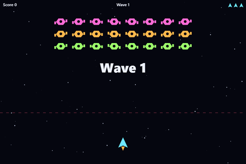 | **Nova Patrol (space shooter)**<br>Enemy waves, bullets, homing missiles, collisions | Intermediate | 358 | [Play](https://bytenimble.github.io/free-html5-games/games/space-shooter/) · [Code](games/space-shooter/index.html) · [Tutorial](https://html5gamesstudio.com/html-game-code/space-shooter) |
| 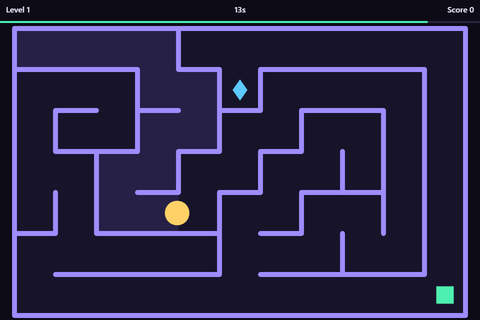 | **Maze Dash (maze)**<br>Random maze generation, grid movement, a timer | Intermediate | 365 | [Play](https://bytenimble.github.io/free-html5-games/games/maze-game/) · [Code](games/maze-game/index.html) · [Tutorial](https://html5gamesstudio.com/html-game-code/maze-game) |
| 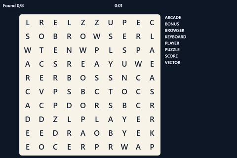 | **Word Search**<br>Placing words in a grid, drag selection, checking answers | Intermediate | 282 | [Play](https://bytenimble.github.io/free-html5-games/games/word-game/) · [Code](games/word-game/index.html) · [Tutorial](https://html5gamesstudio.com/html-game-code/word-game) |
| 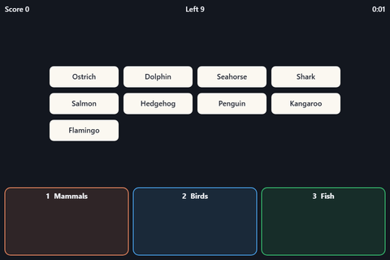 | **Sort It Out (drag and drop)**<br>Pointer Events, picking up, dropping, snap-back | Intermediate | 301 | [Play](https://bytenimble.github.io/free-html5-games/games/drag-and-drop-game/) · [Code](games/drag-and-drop-game/index.html) · [Tutorial](https://html5gamesstudio.com/html-game-code/drag-and-drop-game) |
| 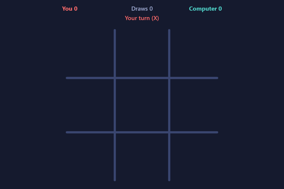 | **Tic-Tac-Toe**<br>Board state, turns, an unbeatable minimax opponent | Intermediate | 315 | [Play](https://bytenimble.github.io/free-html5-games/games/board-game/) · [Code](games/board-game/index.html) · [Tutorial](https://html5gamesstudio.com/html-game-code/board-game) |
| 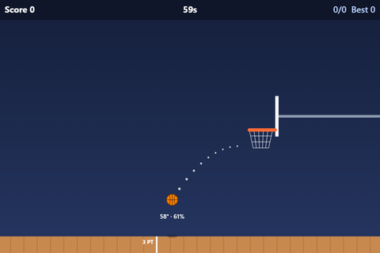 | **Buzzer Hoops (basketball)**<br>Projectile physics, rim and backboard bounces, a timed round | Intermediate | 296 | [Play](https://bytenimble.github.io/free-html5-games/games/sports-game/) · [Code](games/sports-game/index.html) · [Tutorial](https://html5gamesstudio.com/html-game-code/sports-game) |
| 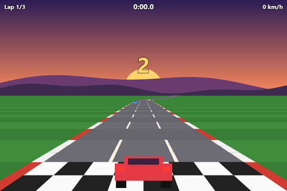 | **Sunset Sprint (pseudo-3D racing)**<br>A pseudo-3D road, curves, hills, traffic, lap timing | Intermediate | 321 | [Play](https://bytenimble.github.io/free-html5-games/games/racing-game/) · [Code](games/racing-game/index.html) · [Tutorial](https://html5gamesstudio.com/html-game-code/racing-game) |
| 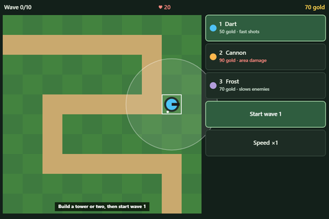 | **Grove Guard (tower defense)**<br>Paths, waves, targeting, three tower types, upgrades | Intermediate | 349 | [Play](https://bytenimble.github.io/free-html5-games/games/tower-defense/) · [Code](games/tower-defense/index.html) · [Tutorial](https://html5gamesstudio.com/html-game-code/tower-defense) |
| 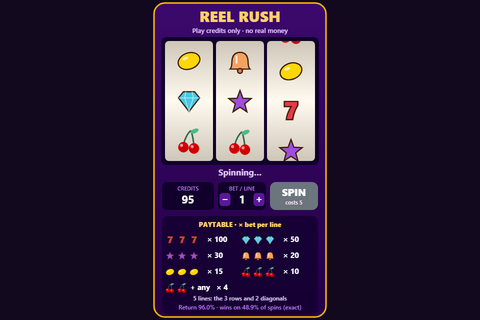 | **Reel Rush (slot machine, play credits only)**<br>Reels, paylines, paytables, RTP and fair randomness | Intermediate | 325 | [Play](https://bytenimble.github.io/free-html5-games/games/casino-games/) · [Code](games/casino-games/index.html) · [Tutorial](https://html5gamesstudio.com/html-game-code/casino-games) |
| 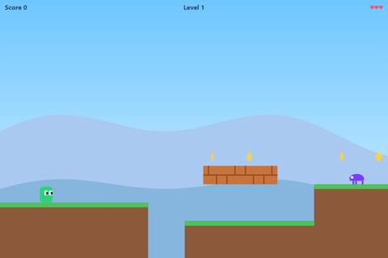 | **Leaf Leap (platformer)**<br>Tile collision, jumping, side-scrolling, enemies | Advanced | 399 | [Play](https://bytenimble.github.io/free-html5-games/games/platformer/) · [Code](games/platformer/index.html) · [Tutorial](https://html5gamesstudio.com/html-game-code/platformer) |

## Run one

1. Download or copy `games/<name>/index.html`.
2. Double-click it. That's it: no server, no install.

Or clone the whole repo:

```bash
git clone https://github.com/bytenimble/free-html5-games.git
```

## Use them

Good for learning, class projects, game jams and prototypes. Give your version its own name: names like Tetris, Pong and Breakout are trademarks, which is why the games here have their own.

## Going further

These files teach the core of each genre. A game people pay for, or that a portal accepts, needs much more: designed levels, original art and sound, saves, portal SDK hooks, localisation and testing on real devices. [HTML5 Games Studio](https://html5gamesstudio.com) makes complete commercial games with full TypeScript source in Phaser 4 and Three.js, if you'd rather start from one.

## License

[MIT](LICENSE). Copyright (c) 2026 HTML5 Games Studio. Keep the license line at the top of each file when you reuse it.
